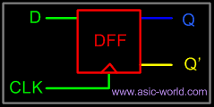
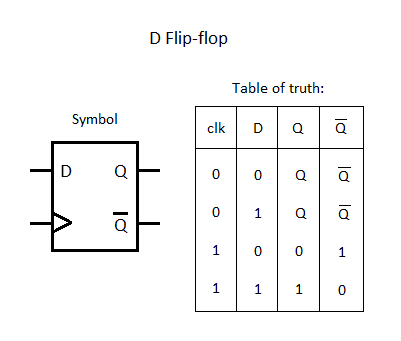
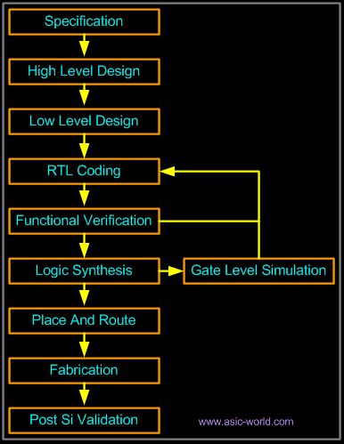

>Trước khi bắt đầu hãy chắc rằng bạn đã biết qua về kiến thức cơ bản của **Nhập môn mạch số** và **Thiết kế luận lý số**.  Bài viết này không tập trung vào các kiến thức mạch số cơ bản mà chỉ tập trung vào việc sử dụng Verilog để hiện thực hóa chúng.

## **Tổng quan**

Verilog, được tiêu chuẩn hóa thành IEEE 1364, là ngôn ngữ mô tả phần cứng (hardware description language, viết tắt: HDL) được sử dụng để mô hình hóa các hệ thống điện tử. Nó được sử dụng phổ biến nhất trong thiết kế và xác minh các mạch kỹ thuật số ở trừu tượng mức chuyển thanh ghi. Nó cũng được sử dụng trong việc xác minh các mạch tương tự và mạch tín hiệu hỗn hợp, cũng như trong thiết kế các mạch di truyền. Vào năm 2009, tiêu chuẩn Verilog (IEEE 1364-2005) đã được hợp nhất vào tiêu chuẩn SystemVerilog, tạo ra tiêu chuẩn IEEE 1800-2009. Kể từ đó, Verilog chính thức là một phần của ngôn ngữ SystemVerilog. Phiên bản hiện tại là tiêu chuẩn IEEE 1800-2017.

Chúng ta có thể mô tả bất kỳ mạch điện tử số nào ở bất kỳ cấp độ nào bằng việc sử dụng Verilog. Ví dụ như các vi xử lý, bộ nhớ hoặc đơn giản như phần tử nhớ Flip-Flop.

## **D Flip-Flop design**

Verilog là một trong những ngôn ngữ HDL có sẵn trong ngành để thiết kế phần cứng, nó cho phép hiện thực các khối mạch số ở các cấp Behavior Level, Register Transfer Level (RTL), Gate level và Switch level. Verilog cho phép các nhà thiết kế phần cứng thể hiện thiết kế của họ với các cấu trúc hành vi (Behavioral constructs). Ví dụ hiện thực phần tử nhớ D Flip-Flop bằng verilog.



Nhìn vào khối DFF ở hình trên chúng ta có thể thấy khối có tên là DFF nhận 1 input là D và cho ra 2 output là Q và Q'. Nào bây giờ cùng xem code verilog của nó. Chúng ta có thể mô tả một D Flip flop đơn giản như trong đoạn code dưới đây, cũng những thiết kế phức tạp có đến hàng triệu triệu cổng logic cũng bằng cách viết code verilog như bên dưới.

```verilog
// D flip-flop Code
module d_ff ( d, clk, q, q_bar);
input d ,clk;       // khai bao input
output q, q_bar;    // khai bao output
wire d ,clk;        // khai bao wire
reg q, q_bar;       // khai bao reg

always @ (posedge clk)
begin               // khi clk = 1
  q <= d;           // Q = D 
  q_bar <= !d;      // Q' = ~D
end

endmodule
```



## **Phong cách thiết kế của Verilog**

Verilog giống như các ngôn ngữ mô tả phần cứng khác, cho phép thiết kế theo phương pháp Từ dưới lên (Bottom-Up Design) hoặc Từ trên xuống dưới (Bottom-Up Design).

### **Bottom-Up Design**

Thiết kế từ dưới lên chính là cách thiết kế mạch số truyền thống, mỗi một thiết kế thì được thực hiện ở mức các cổng logic (gate-level) bằng việc sử dụng các cổng logic tiêu chuẩn. Với sự tăng trưởng của ngành công nghiệp vi mạch cũng như sự ngày càng phức tạp của các thiết kế mới thì việc thiết kế truyền thống như này gây ra rất nhiều khó khăn và khó có thể duy trì.

Những hệ thống mới như ASIC hoặc microprocessors (vi xử lý) với sự phức tạp của hàng trăm ngàn transistor thì cách thiết kế truyền thống dần nhường chỗ cho các cách thiết kế cấu trúc, phân cấp mới. Nếu không có các phương pháp thiết kế mới này việc hiện thực các bộ vi xử lý hay module mạch số phức tạp sẽ trở nên vô cùng khó khăn.

### **Top-Down Design**

Phong cách thiết kế mong muốn của tất cả các nhà thiết kế là phong cách từ trên xuống (Top-Down). Thiết kế từ trên xuống thực sự cho phép thực hiện các bước thử nghiệm sớm hơn, dễ dàng thay đổi các công nghệ khác nhau, thiết kế hệ thống có cấu trúc và cung cấp nhiều lợi thế khác


