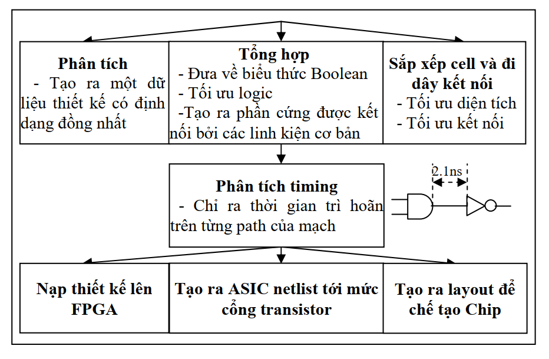

>Tiếp nối P1 thì chúng ta sẽ tiếp tục tìm hiểu về các khâu còn lại trong quy trình thiết kế hệ thống số với HDL.

## **Biên dịch và tổng hợp thiết kế**

Tổng hợp là quá trình tạo ra phần cứng tự động từ một mô tả thiết kế phần cứng tương ứng rõ ràng. Những phong cách viết code một cách nhất định cho mạch tổ hợp cũng như mạch tuần tự. Những phong cách này và cấu trúc Verilog tương ứng của chúng được định nghĩa trong việc tổng hợp RTL.

Như trong sơ đồ quy trình thiết kế đã được trình bày ở phần 1, một thiết kế sau khi được thực hiện mô phỏng tiền tổng hợp và đã được đánh giá kiểm tra xong thì nó sẽ được tiến hành biên dịch để tiến gần hơn đến việc làm ra phần cứng thực sự trên silicon.  

Đầu tiên chúng ta cần chọn ra 1 phần cứng cụ thể (có thể là 1 ASIC, FPGA hoặc Custom IC) như là 1 phần cứng mục tiêu để phát triển thiết kế của chúng ta. Sau khi đã xác định được phần cứng mục tiêu thì chúng ta sẽ dựa trên các tài liệu kỹ thuật của nhà sản xuất cung cấp cho thiết bị phần cứng đó bao gồm: thông số kỹ thuật, chức năng, các tập tin mô tả về công nghệ, tài liệu hướng dẫn chi tiết về định thời và mô tả chức năng cho quá trình biên dịch.

Từ đó thông qua quá trình biên dịch chúng ta sẽ biến đổi được những thành phần khác nhau của thiết kế thành 1 định dạng chung gian *(Bước phân tích)*. Sau đó chúng ta thực hiện kết nối tất cả các thành phần đó lại với nhau và tạo ra mạch logic tương ứng *(Bước tổng hợp)*, và cuối cùng trong khâu này chính là sắp xếp và đi dây kết nối *(Bước sắp xếp cell và đi dây)* các linh kiện phần cứng trong thiết bị mục tiêu lại với nhau từ đó hình thành 1 thiết kế với chức năng như chúng ta muốn thiết kế.

Về mặt tổng quát ở khâu biên dịch thì nó như vậy, ở phần dưới chúng ta sẽ đi vào trong từng bước ở trong khâu biên dịch tổng hợp để xem thiết của chúng ta sẽ được xử lý như thế nào khi đi qua từng bước như trên đã nói.

### **Phân tích**

Một thiết kế hoàn chỉnh được mô tả bởi Verilog có thể sẽ dùng nhiều cách mô tả phần cứng ở nhiều mức độ như behavior level, bus system hoặc kết nối với những linh kiện Verilog khác. Trước khi một thiết kế hoàn chỉnh tạo ra phần cứng, thiết kế phải được phân tích và tạo ra một định dạng đồng nhất cho tất cả các phần trong thiết kế. Bước này cũng để kiểm tra cú pháp và ngữ nghĩa của mã ngõ vào Verilog.

### **Tạo phần cứng**

Sau khi tạo được một dữ liệu thiết kế có định dạng đồng nhất cho tất cả các linh kiện trong thiết kế, bước tổng hợp sẽ bắt đầu bằng chuyển đổi dữ liệu thiết kế trên sang những định dạng phần cứng thông thường như một chuỗi những biểu thức Boolean hay một netlist những cổng cơ bản.

### **Tối ưu logic**

Như đã nói ở trên sau sau khi dữ liệu thiết kế được đồng nhất và tổng hợp ra các chuỗi biểu thức Boolean thì chúng chưa thật sự đã được tối ưu, vì thế nên chúng ta cần thêm 1 bước là sử dụng các phương pháp tối ưu mạch logic (Các phương pháp này đã được nói rõ trong môn học **Nhập môn mạch số**), Bước này nhằm mục đích làm giảm những biểu thức với ngõ vào không đổi, loại bỏ những biểu thức lập lại, tối thiểu hai mức, tối thiểu nhiều mức. Sau khi quá trình tối ưu logic thực hiện xong chúng ta sẽ thu được kết quả ở ngõ ra ở dưới dạng các biểu thức Boolean đã được rút gọn, mô tả logic dưới dạng bảng, hoặc netlist gồm những cổng cơ bản.

### **Binding**

Sau bước tối ưu logic, quá trình tổng hợp sử dụng thông tin từ thiết bị phần cứng mục đích để quyết định chính xác linh kiện logic nào và thiết bị nào cần để hiện thực mạch thiết kế. Quá trình này được gọi là binding và kết quả ngõ ra của nó được chỉ định cụ thể sử dụng cho FPLD, ASIC, hay custom IC.

### **Sắp xếp cell và đi dây kết nối**

## **Mô phỏng hậu tổng hợp**

## **Phân tích timing**

## **Tạo linh kiện phần cứng**
