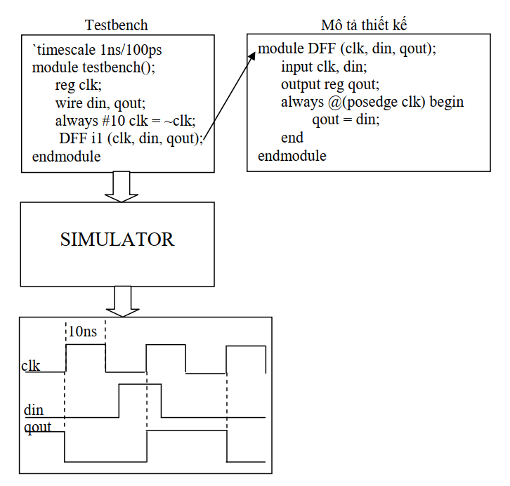

>Trước khi bắt đầu hãy chắc rằng bạn đã biết qua về kiến thức cơ bản của **Nhập môn mạch số** và **Thiết kế luận lý số**.  Bài viết này không tập trung vào các kiến thức mạch số cơ bản mà chỉ tập trung vào việc sử dụng Verilog để hiện thực hóa chúng.

## **Tổng quan**

Trước khi Verilog-HDL ra đời tất cả các thiết kế bất kể là phức tạp hay đơn giản đều dựa trên việc thiết kế schematics. Điều này làm khó khăn hơn cho việc xác minh và dễ xảy ra lỗi, chu kỳ phát triển lại tốn nhiều thời gian mà công việc lại tẻ nhạt, chỉ đơn thuần design...verification, design....verification,design...verification. Khi mạch thiết kế lên đến hàng triệu cổng logic được tích hợp trong một Chip thì việc thiết kế mạch và đi dây kết nối bằng tay trở nên rất rất khó khăn.

Từ những khó khăn đó các ý tưởng về 1 ngôn ngữ có mức trừu tượgn cao để mô tả thiết kế phần cứng được ra đời và đó chính là Verilog. Cùng với sự ra đời của ngôn ngữ mô tả phần cứng Verilog là hàng loạt các công cụ EDA (Electronic Design Automation) và CAD (Computer Aided Design) đã giúp cho những kĩ sư thiết kế vi mạch tạo nên những con Chip có độ tích hợp lên đến hàng triệu cổng logic, cho 1 tốc độ siêu việt và chức năng đa dạng.

## **Qui trình thiết kế hệ thống số**

Quy trình thiết kế hệ thống số sử dụng các công cụ và phương pháp thiết kế tự động được bắt đầu bằng việc mô tả thiết kế tại nhiều mức độ trừu tượng khác nhau và kết thúc bằng việc tạo ra danh sách các linh kiện cũng như các đường kết nối giữa các linh kiện với nhau (netlist) cho một mạch tích hợp với ứng dụng cụ thể (ASIC), mạch in (layout) cho một mạch tích hợp theo yêu cầu khách hàng (custom IC), hoặc một chương trình cho một thiết bị logic có khả năng lập trình được (PLD).

## **Mô tả thiết kế với Verilog**

Thiết kế được mô tả bằng Verilog theo phong cách phân cấp từ cao xuống thấp (top-down). Ở bước này thì nói chung đơn giản là dùng verilog để mô tả lại mạch. Verilog hỗ trợ việc thiết kế với nhiều cấp trừu tượng (Abstraction Levels) khác nhau, nhưng được sử nhiều nhất và quan trọng nhất thì có 3 loại chính:

- Behavioral level
- Register-Transfer Level
- Gate Level

Chúng ta sẽ còn nói về các kiểu thiết kế này ở các phần sau.

## **Mô phỏng**

Chạy mô phỏng dùng trong việc đánh giá thiết kế được thực hiện
trước khi thiết kế được tổng hợp và được thực hiện ở trên các cấp độ Behavior, RTL và Pre-synthetic. Chạy mô phỏng ở mức độ
này sẽ chính xác theo xung clock bởi vì môi trường mô phỏng là môi trường lý tưởng, chưa có các vấn đề tiềm tàng như độ trễ trên cổng và dây kết nối, hazards, glitch, race conditions, timing Setup/hold input,... Một ưu điểm của mô phỏng ở mức độ này so với việc mô phỏng ở mức cổng hoặc mức transistor đó là thời gian mô phỏng nhanh hơn đáng kể.

Nhưng mà để chạy được mô phỏng của 1 thiết kế thì chúng ta lại cần có dữ liệu kiểm tra. Để tạo ra được dữ liệu kiểm tra thì có nhiều cách khác nhau ví dụ như dùng GUI để vẽ dạng sóng hoặc có thể viết testbench,... Sau khi có dữ liệu kiểm tra và thực hiện mô phỏng thì việc cần làm của chúng ta đó là quan sát kết quả ngõ ra đa số ở dạng sóng ngoài ra còn có loại kết quả ngõ ra ở dạng văn bản (Pass hoặc Fail).

### **Viết Testbench**

Khi chạy mô phỏng thì khối thiết kế sẽ được gọi ra để kiểm tra bằng cách đưa dữ liệu testbench vào ngõ vào của khối, như hình trên thì ngõ ra dạng sóng của khối sẽ thay đổi ngay khi xung clock kích cạnh lên do đã bỏ qua thời gian delay ở các cổng và dây kết nối. Trong thực tế thì mỗi linh kiện thực tế sẽ có các đáp ứng khác nhau, thời gian trễ của các khối được sử dụng và cả thời gian từ khi xung clock kích cạnh lên đến khi ra ở ngõ ra mặc dù rất nhỏ nhưng vẫn lớn hơn 0, một điều nữa là nếu lựa chọn tần số xung clock để cấp vào mạch quá cao so với tốc độ truyền tín hiệu ở trên các cổng của transistor sử dụng trong thiết kế thì ngõ ra của thiết kế sẽ không thể xác định được.

Vì những yếu tố nói trên nên việc mô phỏng tiền tổng hợp sẽ không cung cấp các thông tin chi tiết về mặt định thời của thiết kế được mô phỏng. Do đó những vấn đề tiềm ẩn như thời gian trễ trên các cổng, dây kết nối, phần cứng sẽ không được phát hiện. Thay vào đó việc kiểm tra định thời của thiết kế ví dụ như thiết kế nhanh hay chậm, hoạt động ở tần số xung clock bao nhiêu là được sẽ được thực hiện trong quá trình **Mô phỏng hậu tổng hợp**

### **Kĩ thuật chèn kiểm tra (assertion)**

Thay vì phải dò theo kết quả mô phỏng bằng mắt hay tạo những dữ
liệu kiểm tra testbench phức tạp, kĩ thuật chèn thiết bị giám sát có thể được sử dụng để kiểm tra tuần tự những đặc tính của thiết kế trong suốt quá trình mô phỏng. Khi thực hiện chèn thiết bị giám sát vào mô phỏng thì chúng ta cần phải xác định các đặc tính của thiết kế từ đó đặt ra các điều kiện cần đạt được để thoả mãn các đặc tính của thiết kế. Các thiết bị giám sát được cài vào sẽ thông báo lỗi khi có **bất kỳ một đặc tính nào đó của thiết kế được phát hiện là sai**. Có thư viện OVL (Open Verification Library) cung cấp một chuỗi các thiết bị giám sát để chèn vào hệ thống thiết kế nhằm mục đích giám sát những đặc tính thông thường của thiết kế. Thay vì dùng các thiết bị giám sát có sẵn chúng ta có thể dùng những kĩ thuật giám sát của riêng mình để chèn vào thiết kế và dùng chúng kết hợp với testbench trong việc kiểm tra đánh giá thiết kế.

### **Kiểm tra thông thường**

Kiểm tra thông thường là quá trình kiểm tra những đặc tính bất kì của thiết kế. Khi một thiết kế hoàn thành, chúng ta sẽ xây dựng một chuỗi những đặc tính tương ứng với hành vi của thiết kế. Công cụ kiểm tra thông thường sẽ kiểm tra thiết kế để đảm bảo rằng những đặc tính được mô tả đáp ứng được tất cả những điều kiện. Nếu có một đặc tính được phát hiện là không đáp ứng đúng thì đặc tính đó được xem như vi phạm. Độ bao phủ của đặc tính (coverage) chỉ ra bao nhiêu phần trăm đặc tính của thiết kế đã được kiểm tra.

>Vì bài viết cũng khá là dài rồi nên các khâu phía sau chúng ta sẽ cùng nhau tìm hiểu tiếp ở phần 2

## **Nguồn**

- Giáo trình ngôn ngữ mô tả phần cứng Verilog ĐH CNTT - ĐHQG HCM
