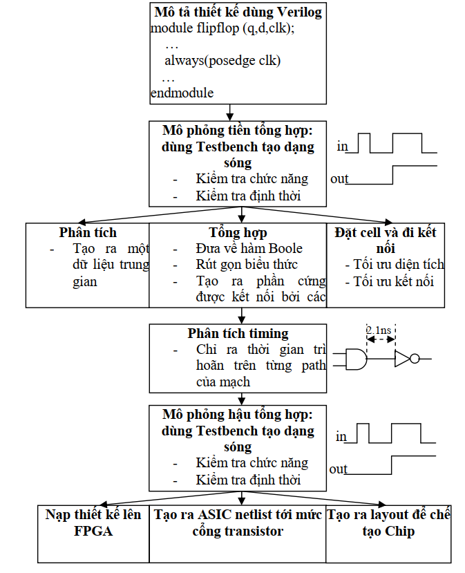
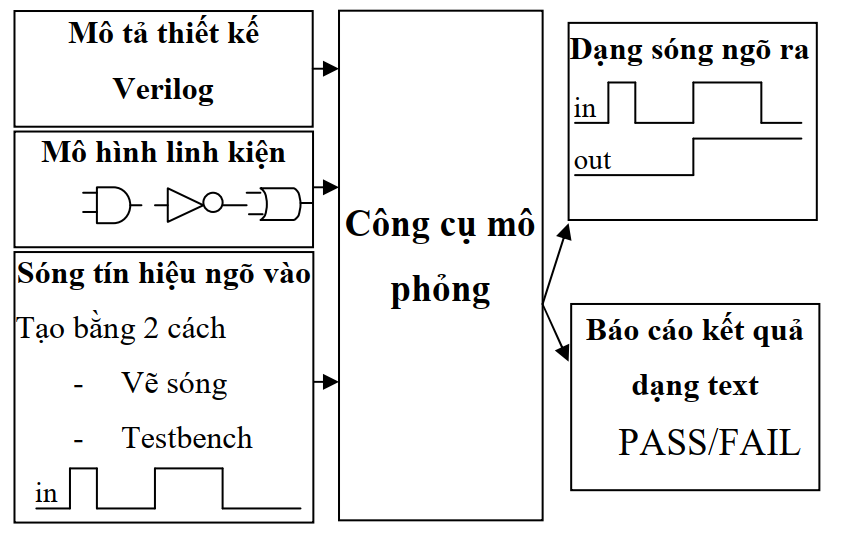

>Trước khi bắt đầu hãy chắc rằng bạn đã biết qua về kiến thức cơ bản của **Nhập môn mạch số** và **Thiết kế luận lý số**.  Bài viết này không tập trung vào các kiến thức mạch số cơ bản mà chỉ tập trung vào việc sử dụng Verilog để hiện thực hóa chúng.

## **Tổng quan**

Trước khi Verilog-HDL ra đời tất cả các thiết kế bất kể là phức tạp hay đơn giản đều dựa trên việc thiết kế schematics. Điều này làm khó khăn hơn cho việc xác minh và dễ xảy ra lỗi, chu kỳ phát triển lại tốn nhiều thời gian mà công việc lại tẻ nhạt, chỉ đơn thuần design...verification, design....verification,design...verification. Khi mạch thiết kế lên đến hàng triệu cổng logic được tích hợp trong một Chip thì việc thiết kế mạch và đi dây kết nối bằng tay trở nên rất rất khó khăn.

Từ những khó khăn đó các ý tưởng về 1 ngôn ngữ có mức trừu tượgn cao để mô tả thiết kế phần cứng được ra đời và đó chính là Verilog. Cùng với sự ra đời của ngôn ngữ mô tả phần cứng Verilog là hàng loạt các công cụ EDA (Electronic Design Automation) và CAD (Computer Aided Design) đã giúp cho những kĩ sư thiết kế vi mạch tạo nên những con Chip có độ tích hợp lên đến hàng triệu cổng logic, cho 1 tốc độ siêu việt và chức năng đa dạng.

## **Qui trình thiết kế hệ thống số**

Quy trình thiết kế hệ thống số sử dụng các công cụ và phương pháp thiết kế tự động được bắt đầu bằng việc mô tả thiết kế tại nhiều mức độ trừu tượng khác nhau và kết thúc bằng việc tạo ra danh sách các linh kiện cũng như các đường kết nối giữa các linh kiện với nhau (netlist) cho một mạch tích hợp với ứng dụng cụ thể (ASIC), mạch in (layout) cho một mạch tích hợp theo yêu cầu khách hàng (custom IC), hoặc một chương trình cho một thiết bị logic có khả năng lập trình được (PLD).

## **Mô tả thiết kế với Verilog**

Thiết kế được mô tả bằng Verilog theo phong cách phân cấp từ cao xuống thấp (top-down). Ở bước này thì nói chung đơn giản là dùng verilog để mô tả lại mạch. Verilog hỗ trợ việc thiết kế với nhiều cấp trừu tượng (Abstraction Levels) khác nhau, nhưng được sử nhiều nhất và quan trọng nhất thì có 3 loại chính:

- Behavioral level
- Register-Transfer Level
- Gate Level

Chúng ta sẽ còn nói về các kiểu thiết kế này ở các phần sau.

## **Mô phỏng tiền tổng hợp**

>Khi chạy mô phỏng 1 thiết kế chúng ta cần chuẩn bị 1 dữ liệu đầu vào, sau đó đưa chúng qua khối thiết kế và quan sát tín hiệu ở ngõ ra xem đã đúng yêu cầu hay chưa thì những dữ liệu dùng để kiểm tra này được gọi là testbench.

Khi một thiết kế dùng Verilog hoàn thành thì chúng ta cần viết các **"testbench"** để kiểm tra xem khối vừa được thiết kế đã đúng chức năng hay chưa. Thông qua quá trình mô phỏng chúng ta có thể phát hiện ra được các lỗi sai về việc không tương thích giữa những linh kiện dùng trong thiết kế. Một testbench sử dụng cấu trúc mức cao của Verilog để tạo ra dữ liệu kiểm tra, quan sát kết quả ở ngõ ra, và cả việc kết nối giữa những tín hiệu trong thiết kế.

Viết ra testbench để thực hiện mô phỏng cũng là 1 bước trọng để thực hiện **đánh giá thiết kế**, và đó cũng là một trong những khâu quan trọng nhất trong quy trình thiết kế.

>Đánh giá thiết kế là quá trình mà người thiết kế sẽ kiểm tra thiết kế của họ có sai sót nào có thể xảy ra trong suốt quá trình thiết kế hay không.

Một sai sót thiết kế có thể xảy ra do sự mô tả thiết kế không rõ ràng, do nhầm lẫn của người thiết kế, hoặc sử dụng không đúng những khối chức năng trong thiết kế. Đánh giá thiết kế có thể thực hiện bằng mô phỏng, bằng việc chèn những kĩ thuật kiểm tra, hoặc kiểm tra thông thường

## **Mô phỏng**

Chạy mô phỏng dùng trong việc đánh giá thiết kế được thực hiện
trước khi thiết kế được tổng hợp và được thực hiện ở trên các cấp độ Behavior, RTL và Pre-synthetic. Chạy mô phỏng ở mức độ
này sẽ chính xác theo xung clock bởi vì môi trường mô phỏng là môi trường lý tưởng, chưa có các vấn đề tiềm tàng như độ trễ trên cổng và dây kết nối, hazards, glitch, race conditions, timing Setup/hold input,... Một ưu điểm của mô phỏng ở mức độ này so với việc mô phỏng ở mức cổng hoặc mức transistor đó là thời gian mô phỏng nhanh hơn đáng kể.

Nhưng mà để chạy được mô phỏng của 1 thiết kế thì chúng ta lại cần có dữ liệu kiểm tra. Để tạo ra được dữ liệu kiểm tra thì có nhiều cách khác nhau ví dụ như dùng GUI để vẽ dạng sóng hoặc có thể viết testbench,... Sau khi có dữ liệu kiểm tra và thực hiện mô phỏng thì việc cần làm của chúng ta đó là quan sát kết quả ngõ ra đa số ở dạng sóng ngoài ra còn có loại kết quả ngõ ra ở dạng văn bản (Pass hoặc Fail).

### **Testbench**

### **Kĩ thuật chèn kiểm tra (assertion)**

### **Kiểm tra thông thường**

## **Biên dịch và tổng hợp thiết kế**

### **Phân tích**

### **Tạo phần cứng**

### **Binding**

### **Sắp xếp cell và đi dây kết nối**

## **Mô phỏng hậu tổng hợp**

## **Phân tích timing**

## **Tạo linh kiện phần cứng**
