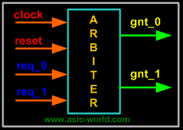

### **Overview**

Verilog, được tiêu chuẩn hóa thành IEEE 1364, là ngôn ngữ mô tả phần cứng (hardware description language, viết tắt: HDL) được sử dụng để mô hình hóa các hệ thống điện tử. Nó được sử dụng phổ biến nhất trong thiết kế và xác minh các mạch kỹ thuật số ở trừu tượng mức chuyển thanh ghi. Nó cũng được sử dụng trong việc xác minh các mạch tương tự và mạch tín hiệu hỗn hợp, cũng như trong thiết kế các mạch di truyền. Vào năm 2009, tiêu chuẩn Verilog (IEEE 1364-2005) đã được hợp nhất vào tiêu chuẩn SystemVerilog, tạo ra tiêu chuẩn IEEE 1800-2009. Kể từ đó, Verilog chính thức là một phần của ngôn ngữ SystemVerilog. Phiên bản hiện tại là tiêu chuẩn IEEE 1800-2017.

Trước khi Verilog-HDL ra đời tất cả các thiết kế bất kể là phức tạp hay đơn giản đều dựa trên việc thiết kế schematics. Điều này làm khó khăn hơn cho việc xác minh và dễ xảy ra lỗi, chu kỳ phát triển lại tốn nhiều thời gian mà công việc lại tẻ nhạt, chỉ đơn thuần verification... design, verification... design, verification...

Khi Verilog ra đời đã tạo ra 1 làn sóng mới trong việc thiết kế mạch logic, thông qua chuỗi bài viết này chúng ta sẽ lần lượt tìm hiểu các nội dung sau:

1. Specifications (specs)
2. High level design
3. Low level (micro) design
4. RTL coding
5. Verification
6. Synthesis

### **Block diagram of arbiter**

Nếu  muốn thiết kế máy trạng thái như trên mà không sử dụng Verilog thì thường chúng ta sẽ phải vẽ 1 máy trạng thái, từ đây chúng ta sẽ lập ra bảng sự thật với các chuyển đổi trạng thái cho mỗi con Flip-Flop. Sau đó thực hiện vẽ bìa Karnaugh từ bìa Karnaugh chúng ta có thể đơn giản các cổng luận lý và cuối cùng ra được mạch. Cách làm này ở những mạch nhỏ thì vẫn có thể ổn, nhưng khi mạch trở nên phức tạp thì cách làm này trở nên phức tạp và tiềm ẩn nhiều lỗi phát sinh. Và rồi Verilog ra đời và cho chúng ta 1 hướng tiếp cận khác để thiết kế mạch, chi tiết hơn thì chúng ta cùng đi tới phần tiếp theo.

### **Low level design**

