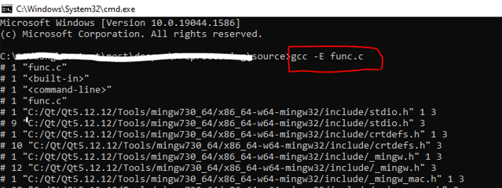
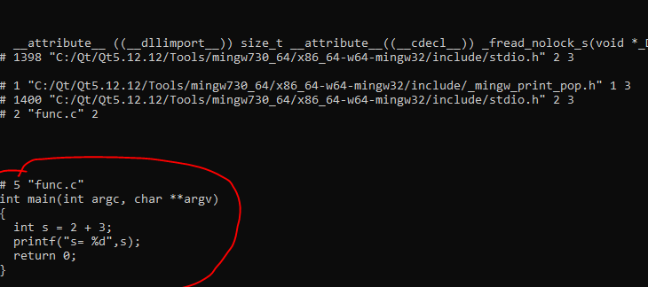

>Bài viết này mình ghi chú lại khi tìm hiểu về macros ở trong C, trước khi đọc bài này thì mình nghĩ là bạn đọc nên có kiến thức cơ bản về C là tối ưu nhất, còn nếu bạn chưa biết gì về C thì cũng không sao, bạn có thể đọc qua rồi sau này gặp thì áp dụng cũng được ^^

## **Chỉ thị tiền xử lý (preprocessor directives)**

Tiền xử lý là 1 tính năng mạnh mẽ của ngôn ngữ lập trình C, nhờ tính năng này là các lập trình viên có thể sửa đổi mã nguồn trước khi chúng được chuyển đến cho compiler. Bước tiền xử lý này cũng là bước được xử lý đặc biệt của C và C++ mà lại không có ở hầu hết các ngôn ngữ bậc cao hiện nay.

Chỉ thị tiền xử lý là các chỉ thị (lệnh) được cung cấp cho bộ tiền xử lý để xử lý mã nguồn trước khi gửi mã nguồn đi đến compiler. Các chỉ thị này thì sẽ bắt đầu với dấu **#** ở đầu. Bản thân compiler cũng không hiểu các chỉ thị này, mà các chỉ thị này sẽ được xử lý trực tiếp ở Bộ tiền xử lý, sau khi Bộ tiền xử lý đã xử lý xong hết các chỉ thị xuất hiện trong cả file header và file source thì lúc này source code hoàn chỉnh mới được gửi đến cho compiler.

Trong C có khá nhiều loại chỉ thị nhưng trong khuôn khổ nội dung ghi chú này, mình chỉ trình bày các chỉ thị quan trọng hay được xử dụng nhất như định nghĩa macros,... Còn các chỉ thị nâng cao xin hẹn ở một bài viết khác.

## **Macros**

Bạn đọc hiểu nôm na Macros là 1 cách đặt tên trong C và thường được hay sử dụng cho các ứng dụng dưới đây:

- Định nghĩa hằng
- Dùng để thay thế cho việc viết 1 hàm bằng C
- Loop unrolling
- Bảo vệ header
- Sinh code
- Biên soạn lại code theo điều kiện

Để định nghĩa macros chúng ta sử dụng chỉ thị `#define` chi tiết như nào thì chúng ta sẽ đi vào các ví dụ ở trong các phần tiếp theo ở dưới đây.

## **Định nghĩa một Macros**

Một macros được định nghĩa bởi chỉ thị `#define` theo sau chỉ thị này là 1 *tên* của marco và 1 danh sách các tham số (có thể có hoặc không). Đó cũng chính là giá trị được thay thế cho *tên* của marco trong mã nguồn thông qua 1 bước là *macro expansion*. Một macros cũng có thể là *undefined* khi sử dụng chỉ thị `#undef`. Chúng ta cùng đi qua ví dụ dưới để để có thể dễ hình dung hơn:

```c
#include <stdio.h>

#define y 9

int main(void) {
    // sau khi buoc macro expansion hoan thanh
    // y se dc thay the = 9
    int x = 2;          
    int s = x + y;      //  s = x + 9
    printf("s= %d", s); // s = 11
    return 0;
}
```

Trong đoạn code trên chúng ta có thể thấy `y` không phải là 1 biến `int` cũng không phải là 1 hằng `int`. `y` đơn thuần là 1 marco và nó có tên là `y` tương ứng giá trị là `9` sau khi bộ tiền xử lý thực hiện xong bước *macro expansion* thì đoạn mã nguồn ở dưới đây sẽ được gửi đến compiler:

```c
#include <stdio.h>

#define y 9

int main(void) {
    int x = 2;          
    int s = x + 9;      
    printf("s= %d", s); 
    return 0;
}
```

Bây giờ thêm 1 ví dụ khác để chúng ta hiểu rõ thêm về bước  *macro expansion*

```c
#include <stdio.h>

#define SUM(a,b) a + b

int main(int argc, char **argv)
{
  int s = SUM(2,3);
  printf("s= %d",s); // s= 5
  return 0;
}
```

Như đoạn code trên chúng ta thấy `SUM` không phải là 1 hàm, nó chỉ trông giống như hàm. Chính xác thì nó chính là 1 macro có nhận tham số truyền vào. Sau thi qua bước  *macro expansion* thì đoạn code trên sẽ được xử lý thành như sau:

Nếu bạn sử dụng `gcc` hoặc `clang` để build thì có thể thêm tham số `-E` vào lệnh build để có thể xem mã nguồn được chỉnh sửa sau khi qua bước tiền xử lý như hình dưới:





Khi chúng ta gọi marco `SUM(2,3)` thì sẽ tương ứng với các tham số truyền vào theo thứ tự như chúng ta đã định nghĩa ở trên, trong đoạn code trên thì `a = 2` và `b = 3` từ đó tất cả các tham số `a` ở phần định nghĩa giá trị của macro sẽ được thay thế bằng `2`, đối với tham số `b` sẽ làm tương tự. Sau khi thay thế hết các giá trị tham số truyền vào thì bước cuối cùng sẽ thay thế tên của macro bằng giá trị macro đã được thay thế tham số, ở đoạn code trên thì `SUM(2,3)` sẽ được thay thế bằng `2 + 3`

Chúng ta có thể sử dụng marco để định nghĩa 1 hàm và dùng nó thay thế cho việc viết 1 hàm C và gọi nó ra. Làm như vậy thì khi đi qua bước tiền xử lý, thì macro sẽ được thay thế bằng logic của hàm mà chúng ta đã định nghĩa, việc thay đổi này là thay đổi trực tiếp trên source code, đây là 1 điểm khác so với hàm C bình thường vốn dĩ muốn thực thi logic của hàm C chúng ta phải thực hiện 1 lời gọi hàm. Tất nhiên là đánh đổi lại việc sử dụng macro như vậy cũng sẽ có nhược điểm, phần này chúng ta sẽ tìm hiểu thêm ở phần sau.

>Có 1 điều khá là quan trọng khi sử dụng macro đó là macro chỉ tồn tại đến bước tiền xử lý và compiler sẽ không biết gì về macro cả. Vì vậy khi bạn muốn sử dụng macro thay cho hàm bình thường thì hãy để ý đến việc này. Compiler có thể hiểu được hàm bởi vì hàm là 1 phần trong cú pháp của C. Hàm khi gửi đến compiler nó sẽ được phân tích cú pháp và đưa vào *cây phân tích cú pháp* (parse tree) còn macro chỉ là 1 chỉ thị tiền xử lý và chỉ có Bộ tiền xử lý hiểu nó.

## **Variadic macros**

## **Ưu Nhược điểm khi sử dụng macros**

## **Nguồn tham khảo**

- <https://en.cppreference.com/w/c/preprocessor>
