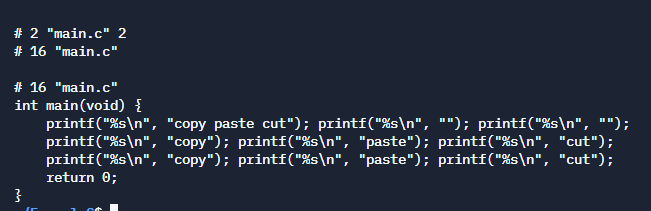

>Nếu bạn chưa đọc Phần 1 thì nên đọc qua phần 1 trước nhé, vì ở phần 1 chúng ta đã đi tìm hiểu khá kỹ lưỡng về macro. Còn nếu bạn không thích đọc Phần 1 thì cũng không sao cả, cứ đọc luôn phần 2 cũng không sao :v

## **Variadic macros**

Tiếp theo chúng ta cùng nhau đi tìm hiểu tiếp về *Variadic macros*, nó cũng là macro thôi nhưng mà điểm hay ho của nó đó là nó có thể nhận vào 1 số lượng đối số không nhất định. Có thể là 2 đối số cũng có thể là 3 hoặc cũng có thể là 8, nhận vào bao nhiêu là tuỳ thuộc vào người sử dụng nó. Cũng nhờ tính chất chất này mà nó rất hữu dụng khi chúng ta cần định nghĩa các macro mà chưa biết được số lượng tham số truyền vào hoặc là số lượng tham số có thể thay đổi tuỳ từng trường hợp. Đoạn code dưới đây là 1 ví dụ:

```c
#include <stdio.h>
#include <stdlib.h>
#include <string.h>

#define VERSION "1.4.22"
#define AUTHOR "Admin"

#define LOG_ERROR(pfile, format, ...) \
  fprintf(pfile, format, __VA_ARGS__)

int main(int argc, char **argv)
{
    FILE *pf;
    pf = fopen ("log.txt", "a+");
    if(argc != 3){
      LOG_ERROR(pf, "Chỉ nhận 2 tham số đầu vào ====> VERSION: %s\n", VERSION);
      exit(-1);
    }
    int x = atoi(argv[1]);
    int y = atoi(argv[2]);
    if(y == 0){
      LOG_ERROR(stderr, "Lỗi không thể chia cho 0 ====> VERSION: %s ====> AUTHOR: %s\n", VERSION, AUTHOR);
      exit(-1);
    }
    else
      return x/y;
}
```

Trong ví dụ trên thì có 2 điểm cần lưu ý trong phần định nghĩa của macro như bên, đầu tiên là dấu `...` phần tên của macro, nó là đối số cuối cùng trong định nghĩa macro, thứ 2 là ký tự nhận diện `__VA_ARGS__`, ký tự `__VA_ARGS__` chỉ cho Bộ tiền xử lý biết để thay thế nó bằng toàn bộ các đối số đầu vào còn lại mà chưa được gán cho bất kỳ tham số nào. Các tham số còn lại này chính là những đối số đầu vào được thay thế vào chỗ của đối số `...` trông mình giải thích nó khá là lôi thôi nhỉ :) thôi đi vào ví dụ sẽ dễ hiểu hơn, như định nghĩa trên thì khi chúng ta gọi `LOG_ERROR(pf, "Chỉ nhận 2 tham số đầu vào ====> VERSION: %s\n", VERSION);` thì đối số `pf` tương ứng với tham số `pfile` trong phần định nghĩa, tương tự đối số `format` với đoạn code sau `"Chỉ nhận 2 tham số đầu vào ====> VERSION: %s\n"` *mỗi đối số sẽ phân chia nhau bằng dấu chấm phẩy*, và tất cả các đối số được truyền thêm ở tiếp theo như `VERSION` sẽ tương ứng với `...` và tất cả chúng cũng sẽ được thay thế vào chỗ của `__VA_ARGS__` bao gồm cả dấu chấm phẩy ở giữa. Sau khi thực hiện tiền xử lý thì ví dụ trên sẽ có mã nguồn như sau:

```c
........................
int main(int argc, char **argv)
{
    FILE *pf;
    pf = fopen ("log.txt", "a+");
    if(argc != 3){
      fprintf(pf, "Chỉ nhận 2 tham số đầu vào ====> VERSION: %s\n", "1.4.22");
      exit(-1);
    }
    int x = atoi(argv[1]);
    int y = atoi(argv[2]);
    if(y == 0){
      fprintf(stderr, "Lỗi không thể chia cho 0 ====> VERSION:%s ====> AUTHOR: %s\n", "1.4.22", "Admin");
      exit(-1);
    }
    else
      return x/y;
}
```

Như vậy là chúng ta đã hiểu cơ bản về Variadic macros, bây giờ chúng ta sẽ đi vào 1 ví dụ khá nổi tiếng về việc sử dụng liên tục các macro để *bắt chước* vòng lặp.

>Trước khi C++ có `foreach`, thư viện boost đã và vẫn đang cung cấp foreach bằng cách sử dụng 1 số của macro. Bạn có thể tìm được định nghĩa của BOOST_FOREACH ở cuối cùng trong file header sau: <https://www.boost.org/doc/libs/1_35_0/boost/foreach.hpp>

```c
#include <stdio.h>

#define LOOP_3(X, ...) \
    printf("%s\n", #X);

#define LOOP_2(X, ...) \
    printf("%s\n", #X); \
    LOOP_3(__VA_ARGS__)

#define LOOP_1(X, ...) \
    printf("%s\n", #X); \
    LOOP_2(__VA_ARGS__)

#define LOOP(...) LOOP_1(__VA_ARGS__)

int main(void) {
    LOOP(copy paste cut)
    LOOP(copy, paste, cut)
    LOOP(copy, paste, cut, select)
    return 0;
}
```

Ví dụ trên đây chỉ là 1 vòng lặp đơn giản và chưa thể so sánh với BOOST_FOREACH được, nhưng mà nó sẽ cho chúng ta 1 số ý tưởng về việc sử dụng variadic macro để lặp lại 1 số lệnh. Hãy xem mã nguồn sau khi được tiền xử lý sẽ ra sao nào:



Như trong mã nguồn sau khi tiền xử lý, chúng ta thấy không có 1 vòng lặp nào cả. Chúng đơn giản chỉ là các câu lệnh `printf`, Bộ tiền xử lý chỉ thay thế các macro bằng các giá trị mà ta đã định nghĩa. Như vậy để có vòng lặp với 1000 lần thì cũng sẽ tương đương với 1000 lệnh trong C. Chúng ta sẽ không có bất kỳ vòng lặp nào trong mã nguồn cuối cùng gửi đến conpiler cả.

Trong hàm `main` ở lần gọi `LOOP(copy paste cut)` đầu tiên, chúng ta truyền vào là `"copy paste cut"` chúng không có dấu `,` để phân chia các đối số, nên Bộ tiền xử lý coi như nó là 1 đối số duy nhất và nó được thay thế vào vòng `LOOP1`, `LOOP2` và `LOOP3` vì không có đối số nên chúng sẽ được thay thế bằng `""` tức là không có gì cả.

Ở lần gọi `LOOP(copy, paste, cut)` thứ 2, chúng ta cung cấp đầy đủ 3 đối số và lần lượt `copy` sẽ được truyền vào đối số cho `LOOP1`, `paste` làm đối số cho `LOOP2` và `cut` làm đối số cho `LOOP3` hoàn toàn theo thứ tự tương ứng. Như vậy thì khi chạy sẽ in ra 3 dòng `copy`, `paste`, `cut`.

Ở lần gọi `LOOP(copy, paste, cut, select)` chúng ta đã truyền tới 4 giá trị, nhưng sự thật là chỉ có 3 trong số đó là đã được xử lý và cho ra kết quả giống với cách thứ 2. Vì chúng ta chỉ định macro lặp được 3 lần nên chúng chỉ có thể lặp 3 lần, Các đối số mở rộng từ thứ 4 trở đi sẽ bị bỏ qua.

>Việc thêm quá số lượng đối số đã định nghĩa như thế này không giống như việc truyền quá số lượng đối số vào hàm và sẽ không bị trình biên dịch báo lỗi bởi vì khi qua tiền xử lý mã nguồn C của chúng ta sẽ không có gì sai cả. Bộ tiền xử lý đơn giản chỉ bỏ qua những đối số bị dư và như vậy nó sẽ không xuất hiện trong mã nguồn cuối cùng.

Có 1 nhược điểm của cách này sẽ làm tăng kích thước mã nguồn và kích thước file thực thi cuối cùng. Nhưng đổi lại cách làm này lại cho hiệu năng nhỉnh hơn so với việc mở 1 vòng lặp `for` hoặc `while`. Chúng ta sẽ cần đánh đổi giữa kích thước file thực thi và hiệu năng. Vấn đề này chúng ta sẽ thảo luận kỹ hơn ở phần 3 **Tản mạn về macro**. Tiếp theo chúng ta sẽ đi thêm về 1 loại macro nữa trước khi kết thúc bài viết này vì nó cũng khá dài rồi.

## **Conditional compilation**

*Conditional compilation* là một tính năng độc đáo khác của C. Nó cung cấp cho chúng ta công cụ để có thể quyết định mã nguồn sau khi tiền xử lý sẽ như thế nào tuỳ theo các điều kiện. Để sử dụng được *Conditional compilation* thì chúng ta có thể tham khảo qua các chỉ thị sau:

- #ifdef
- #ifndef
- #else
- #elif
- #endif

Lý thuyết thì nó vậy, bây giờ chúng ta cùng đi vào ví dụ để xem nó hoạt động như thế nào nhé

```c
#define CONDITION
int main(int argc, char** argv) {
#ifdef CONDITION
  printf("Kitaro Blog CONDITION");
#endif
  printf("Kitaro Blog NOT CONDITION");
  return 0;
}
```

Khi mã nguồn trên được đưa vào Bộ tiền xử lý thì Bộ tiền xử lý sẽ kiểm tra xem macro `CONDITION` đã được định nghĩa hay chưa, nếu `CONDITION` đã được định nghĩa rồi thì tất cả code ở trong khối `#ifdef` và `#endif` sẽ được sao chép đến mã nguồn cuối cùng. Còn nếu `CONDITION` chưa được định nghĩa thì đoạn code  ở trong khối `#ifdef` và `#endif` sẽ bị bỏ qua và tất nhiên là chúng sẽ không xuất hiện ở trong mã nguồn cuối cùng rồi.

>Có 1 điểm chú ý đó là khi chúng ta định nghĩa 1 macro mà không cần khai báo bất kỳ giá trị nào đi kèm với macro đó thì vẫn được tính là hợp lệ.

Sau quá trình tiền xử lý thì mã nguồn của ví dụ trên sẽ như sau:

```c
int main(int argc, char** argv) {
  printf("Kitaro Blog CONDITION");
  printf("Kitaro Blog NOT CONDITION");
  return 0;
}
```

Bạn cũng có thể định nghĩa các macro bằng lệnh khi build mã nguồn bằng GCC hoặc CLang với đối số `-D`. Ví dụ:

```bash
gcc -DCONDITION main.c
```

Một chỉ thị cực kỳ phổ biến đó nữa là `#ifndef`, chúng được sử dụng để bảo vệ các file header, tránh việc các file header sẽ bị đưa vào quá trình tiền xử lý nhiều hơn một lần. Trong hầu hết các dự án C/C++ chúng ta sẽ bắt gặp chỉ thị này ở ngay đầu file header. ví dụ

```c
#ifndef FOO_H
#define FOO_H
  ...code
#endif
```

Cách hoạt động của nó thì cũng khá đơn giản, ở lần đầu tiên thì `FOO_H` chưa được định nghĩa thì nó đoạn code ở trong `#ifndef` và `#endif` sẽ được xử lý, sau lần này thì `FOO_H` đã được định nghĩa, vì vậy đoạn code ở trong `#ifndef` và `#endif` sẽ không thực hiện nữa.

Ngoài chỉ thị trên chúng ta có thể sử dụng 1 chỉ thị là `#pragma once` với công dụng tương tự. Điều khác biệt của `#ifndef` và `#pragma once` đó chính là `#pragma once` không nằm trong *bộ tiêu chuẩn C* (C standard) mặc dù thực tế là nó được hỗ trợ bởi hầu hết các bộ tiền xử lý của C.

Ví dụ lại code trên bằng việc sử dụng `#pragma once` như sau:

```c
#pragma once
...code
```

Đến đây cơ bản là cũng đủ cơ bản để chúng ta có thể làm việc với macro được rồi. Hẹn bạn đọc ở **Phần 3 Tản mạn về macro** 

## **Nguồn**

- Extreme C: Taking you to the limit in Concurrency, OOP, and the most advanced capabilities of C 1st Edition - Kamran Amini (PDF Book)
- <https://en.cppreference.com/w/c/preprocessor>
