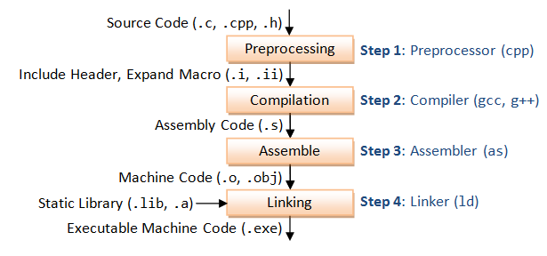

## **Quá trình biên dịch**

Biên dịch là quá trình chuyển đổi từ ngôn ngữ lập trình bậc cao (C/C++, Pascal, Java, C#,…) ra thành mã máy (mã nhị phân) để CPU có thể hiểu và thực hiện. Các ngôn ngữ lập trình khác nhau sẽ có các quy trình biên dịch khác nhau, trong khuôn khổ bài viết này mình chỉ tìm hiểu về quá trình biên dịch trong ngôn ngữ lập trình C. Các quy trình biên dịch của các ngôn ngữ khác nếu có dịp chúng ta sẽ tìm hiểu sau.

Quá trình biên dịch của C được chia làm 4 giai đoạn như ảnh sau



Giới thiệu sơ qua cơ bản thì cũng chỉ có vậy, ở các phần tiếp theo chúng ta sẽ đi chi tiết thêm vào từng khâu của quá trình trên.

## **Build Source code**

Chúng ta viết 1 ví dụ đơn giản để thực hiện compile như sau:

```c
// sortint.h
#ifndef EXAMPLE_SORT
#define EXAMPLE_SORT
#include <stdlib.h>

typedef enum {
  ASCENDING,
  DECREASE
} type_compare;

// Function declaration
void swapInt(int *a, int *b);
void sortInt(int*, type_compare);

#endif
```

```c
// sortint.c
#include "calc.h"

void swapInt(int *a, int *b){
    int tmp = *a; 
    *a = *b; 
    *b = tmp;
}

void sortInt(int* a, type_compare type){
    for (int i = 0; i < 5-1; i++)
    {
        for (int j = i+1; j < 5; j++)
        {
            if (type == ASCENDING ? a[i] > a[j] : a[i] < a[j])
            {
                swapInt(&a[i], &a[j]);
            }
            
        }
    }
}
```

```c
// main.c
#include <stdio.h>
#include "sortint.h"

int main(){
    int *arr = (int *)malloc( 5 * sizeof(int));
    arr[0]=12;
    arr[1]=5;
    arr[2]=20;
    arr[3]=16;
    arr[4]=30;

    sortInt(arr, DECREASE);

    for (int i = 0; i < 5; i++)
    {
        printf("%d", arr[i]);
    }
    
    free(arr);

    return 0;
}
```

Trong phạm vi bài viết chúng ta sẽ tập trung chính vào quá trình compile ví dụ trên. Ví dụ trên thì cũng khá đơn giản chỉ đơn giản là viết 1 hàm sort thôi. Mục đích chia ra file riêng là để phục vụ cho việc thực hiện biên dịch ở các bước sau.

## **Preprocessing**

Quá trình Preprocessing chúng ta đã có dịp đi tìm hiểu ở 3 bài viết trước, nếu bạn chưa đọc thì có thể đọc lại ở [đây](https://kitaro.fun/post/deep-c/preprocessing/ "Tiền xử lý"). Có một điểm mà mình chưa đề cập đến ở các bài trước đó chính là Bộ tiền xử lý đó là nó cần 1 [Parser](https://en.wikipedia.org/wiki/Parsing#Parser "Parser") để phân tích cú pháp của file mã nguồn đầu vào rồi sau đó mới đến các bước khác trong quá trình tiền xử lý.

>Việc phân tích cú pháp của file mã nguồn đầu vào ở đây chính là việc đi tìm ra các chỉ thị (directives) ở trong file mã nguồn input.

Parser mà Bộ tiền xử lý sử dụng khác với Parser ở trong C compiler vì cú pháp của độc lập hoàn toàn so với cú pháp của C. Cũng vì độc lập như vậy nên nó cho phép chúng ta sử vào các mục đích khác ngoài việc xây dựng một chương trình c.

Sơ qua thì vậy thôi, quay lại với việc chính thì trong hầu hết các nền tảng họ nhà Unix thì đều có 1 tools gọi là `cpp`, `cpp` ở đây là viết tắt của *C Pre-Processor* chứ không phải là *C plus plus* đâu :) nó nằm trong gói phát triển C và được cung cấp cho hầu hết các phiên bản Unix. Và GCC cũng đang sử dụng ông này để thực hiện preprocessing.  Nói lý thuyết lâu la vậy chứ để thực hiện tiền xử lý cho C file thì chúng ta đơn giản chỉ cần run lệnh sau:

```bash
cpp sortint.c > sortint.i
```

>Bạn đọc tự kiểm tra kết quả bằng cách so sánh kết quả của tools cpp với kết quả khi thực hiện bằng gcc kèm đối số -E nhé

Kết quả sau quá trình pre-processing sẽ được ghi vào file có format mở rộng `.i` và nó cũng chính là input để gửi đến compiler để thực hiện Compilation.

Như vậy là đã xong bước tiền xử lý rồi :) lý thuyết chi tiết thì nó nhiều chứ còn nắm bắt được các lệnh để thực thi thì nó cơ bản cũng có vậy thôi à. Còn nếu bạn muốn tìm hiểu chi tiết hay nghiên cứu sâu về các công nghệ để phát triển ngôn ngữ lập trình thì có thể tham khảo qua tài liệu chính thứ của [The GNU C Preprocessor Internals](http://www.chiark.greenend.org.uk/doc/cpp-4.3-doc/cppinternals.html "The GNU C Preprocessor Internals"). Trong tài liệu trên có mô tả chi tiết về cách hoạt động của  **GNU C preprocessor**, cách nó phân tích cú pháp của từ các chỉ thị (directives), cách nó tạo ra *parser tree* ngoài ra còn  giải thích các thuật toán được ứng dụng trong bước *macro expansion*. Nói chung là đủ để bạn có thể tự triển khai được 1 bộ tiền xử lý cho ngôn ngữ lập trình của riêng bạn hoặc cũng có thể tự viết 1 bộ tiền xử lý để xử lý các định dạng text file khác...  

## **Compilation**

## **Asemble**

## **Linking**

## **Nguồn**

- Extreme C: Taking you to the limit in Concurrency, OOP, and the most advanced capabilities of C 1st Edition - Kamran Amini (PDF Book)
- <https://www.toptal.com/c-plus-plus/c-plus-plus-understanding-compilation>
- <http://www.chiark.greenend.org.uk/doc/cpp-4.3-doc/cppinternals.html>
