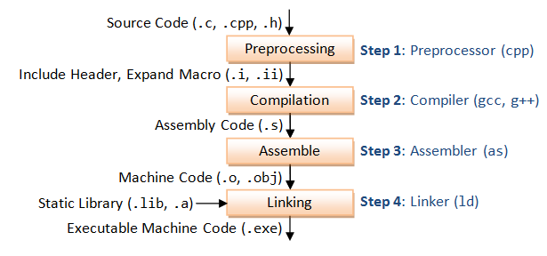
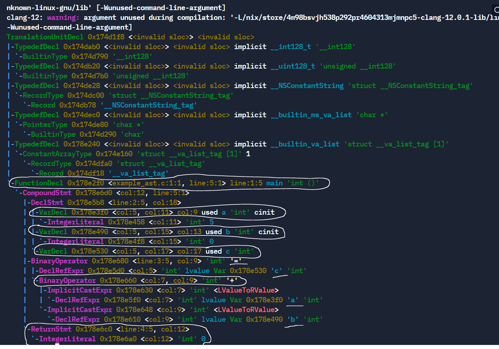
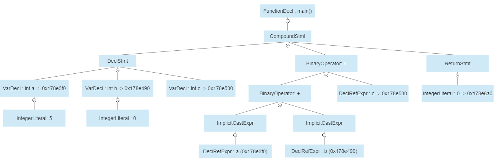

## **Quá trình biên dịch**

Biên dịch là quá trình chuyển đổi từ ngôn ngữ lập trình bậc cao (C/C++, Pascal, Java, C#,…) ra thành mã máy (mã nhị phân) để CPU có thể hiểu và thực hiện. Các ngôn ngữ lập trình khác nhau sẽ có các quy trình biên dịch khác nhau, trong khuôn khổ bài viết này mình chỉ tìm hiểu về quá trình biên dịch trong ngôn ngữ lập trình C. Các quy trình biên dịch của các ngôn ngữ khác nếu có dịp chúng ta sẽ tìm hiểu sau.

Quá trình biên dịch của C được chia làm 4 giai đoạn như ảnh sau



Giới thiệu sơ qua cơ bản thì cũng chỉ có vậy, ở các phần tiếp theo chúng ta sẽ đi chi tiết thêm vào từng khâu của quá trình trên.

## **Build Source code**

Chúng ta viết 1 ví dụ đơn giản để thực hiện compile như sau:

```c
// sortint.h
#ifndef SORTINT
#define SORTINT
#include <stdlib.h>

typedef enum {
  ASCENDING,
  DECREASE
} type_compare;

// Function declaration
void swapInt(int *a,int *b);
void sortInt(int*, int n, type_compare);

#endif

```

```c
// sortint.c
#include "sortint.h"

void swapInt(int *a, int *b){
    int tmp = *a;
    *a = *b;
    *b = tmp;
}

void sortInt(int* a, int n, type_compare type){
    for (int i = 0; i < n-1; i++)
    {
        for (int j = i+1; j < n; j++)
        {
            if (type == ASCENDING ? a[i] > a[j] : a[i] < a[j])
            {
                swapInt(&a[i], &a[j]);
            }

        }
    }
}

```

```c
// main.c
#include <stdio.h>
#include "sortint.h"

#define N_ARRAY 5

int main(){
    int *arr = (int *)malloc( N_ARRAY * sizeof(int));
    arr[0]=12;
    arr[1]=5;
    arr[2]=20;
    arr[3]=16;
    arr[4]=30;

    sortInt(arr,N_ARRAY, DECREASE);

    for (int i = 0; i < N_ARRAY; i++)
    {
        printf("%d", arr[i]);
    }

    free(arr);

    return 0;
}

```

Trong phạm vi bài viết chúng ta sẽ tập trung chính vào quá trình compile ví dụ trên. Ví dụ trên thì cũng khá đơn giản chỉ đơn giản là viết 1 hàm sort thôi. Mục đích chia ra file riêng là để phục vụ cho việc thực hiện biên dịch ở các bước sau.

## **Preprocessing**

Quá trình Preprocessing chúng ta đã có dịp đi tìm hiểu ở 3 bài viết trước, nếu bạn chưa đọc thì có thể đọc lại ở [đây](https://kitaro.fun/post/deep-c/preprocessing/ "Tiền xử lý"). Có một điểm mà mình chưa đề cập đến ở các bài trước đó chính là Bộ tiền xử lý đó là nó cần 1 [Parser](https://en.wikipedia.org/wiki/Parsing#Parser "Parser") để phân tích cú pháp của file mã nguồn đầu vào rồi sau đó mới đến các bước khác trong quá trình tiền xử lý.

>Việc phân tích cú pháp của file mã nguồn đầu vào ở đây chính là việc đi tìm ra các chỉ thị (directives) ở trong file mã nguồn input.

Parser mà Bộ tiền xử lý sử dụng khác với Parser ở trong C compiler vì cú pháp của nó độc lập hoàn toàn so với cú pháp của C. Cũng vì độc lập như vậy nên nó cho phép chúng ta sử vào các mục đích khác ngoài việc xây dựng một chương trình C.

Sơ qua thì vậy thôi, quay lại với việc chính thì trong hầu hết các nền tảng họ nhà Unix thì đều có 1 tools gọi là `cpp`, `cpp` ở đây là viết tắt của *C Pre-Processor* chứ không phải là *C plus plus* đâu :) nó nằm trong gói phát triển C và được cung cấp cho hầu hết các phiên bản Unix. Và GCC cũng đang sử dụng ông này để thực hiện preprocessing.  Nói lý thuyết lâu la vậy chứ để thực hiện tiền xử lý cho C file thì chúng ta đơn giản chỉ cần run lệnh sau:

```bash
cpp sortint.c > sortint.i
```

>Bạn đọc tự kiểm tra kết quả bằng cách so sánh kết quả của tools cpp với kết quả khi thực hiện bằng gcc kèm đối số -E nhé

Kết quả sau quá trình pre-processing sẽ được ghi vào file có format mở rộng `.i` và nó cũng chính là input để gửi đến compiler để thực hiện Compilation.

>*translation unit* chính là file mã nguồn được tạo ra bởi Bộ tiền xử lý thông qua quá trình tiền xử lý. Chúng ta đã được xử lý hết tất cả các chỉ thị tiền xử lý (include, define,...) và sẵn sàng được gửi đến compiler để thực hiện quá trình compilation. file `.i` ở trên chính là 1 *translation unit*.

Như vậy là đã xong bước tiền xử lý rồi :) lý thuyết chi tiết thì nó nhiều chứ còn nắm bắt được các lệnh để thực thi thì nó cơ bản cũng có vậy thôi à. Còn nếu bạn muốn tìm hiểu chi tiết hay nghiên cứu sâu về các công nghệ để phát triển ngôn ngữ lập trình thì có thể tham khảo qua tài liệu chính thức của [The GNU C Preprocessor Internals](http://www.chiark.greenend.org.uk/doc/cpp-4.3-doc/cppinternals.html "The GNU C Preprocessor Internals"). Trong tài liệu trên có mô tả chi tiết về cách hoạt động của  **GNU C preprocessor**, cách nó phân tích cú pháp của từ các chỉ thị (directives), cách nó tạo ra *parser tree* ngoài ra còn  giải thích các thuật toán được ứng dụng trong bước *macro expansion*. Nói chung là đủ để bạn có thể tự triển khai được 1 bộ tiền xử lý cho ngôn ngữ lập trình của riêng bạn hoặc cũng có thể tự viết 1 bộ tiền xử lý để xử lý các định dạng text file khác...  

## **Compilation**

Khi đã có được *translation unit* từ quá trình tiền xử lý, thì compiler sẽ tiến hành biên dịch ra code assembly. Chúng ta có thể xem được nội dung của bước này bằng cách thêm đối số `-S` vào lệnh compile của GCC như sau:

```bash
gcc -S sortint.c
```

Kết quả thu được file `sortint.s` như sau, tất nhiên là mình đã xoá bớt đi rồi chứ nó dài lắm :) chủ yếu show ra để xem cho vui thoai :))))

```asm
  .file "sortint.c"
    .text
    .globl swapInt
    .def swapInt; .scl 2; .type 32; .endef
    .seh_proc swapInt
  swapInt:
    ...
  sortInt:
    pushq %rbp
    .seh_pushreg %rbp
    movq %rsp, %rbp
    .seh_setframe %rbp, 0
    subq $48, %rsp
    .seh_stackalloc 48
    .seh_endprologue
    movq %rcx, 16(%rbp)
    movl %edx, 24(%rbp)
    movl %r8d, 32(%rbp)
    movl $0, -4(%rbp)
    jmp .L3
...
    .ident "GCC: (x86_64-posix-seh-rev0, Built by MinGW-W64 project) 7.3.0"
```

Như là 1 bước trong quá trình biên dịch, conpiler sẽ phân tích cú pháp của translation unit và biên dịch nó thành tập hợp các lệnh assembly tương ứng phù hợp theo từng kiến trúc phần cứng khác nhau. Tức là chung 1 mã nguồn C nhưng sẽ biên dịch ra các mã assembly tương ứng với kiến trúc phần cứng mục tiêu. Ví dụ tập hợp các mã lệnh assembly của kiến trúc ARM 64-bit sẽ khác so với kiến trúc AMD 64-bit vì vậy để chương trình C chạy được trên các kiến trúc phần cứng này thì cần biên dịch các tập lệnh Assembly tương ứng.

>Chúng ta không nhất thiết phải dùng 1 máy host là ARM 32-bit để biến dịch mã nguồn C chạy trên ARM 32-bit. Chúng ta vẫn có thể sử dụng máy host Intel x86-64 để biên dịch mã nguồn C chạy bên trên ARM 32-bit bằng cách sử dụng compiler dành cho ARM 32-bit như *arm-linux-gnueabi-gcc,...*

Việc phải biên dịch đúng tập lệnh assembly cho từng kiến trúc phần cứng là 1 thử thách thật sự trong quá trình compilation. Để xử lý vấn đề này thì gcc và nhiều loại compiler khác đã chia quá trình compilation thành 2 bước: *compiler frontend* và *compiler backend*. Ở bước *compiler frontend* sẽ tiến hành phân tích cú pháp của translation unit thành *Abstract Syntax Tree (AST)* ở bước này chưa cần quan tâm tới kiến trúc tập lệnh của phần cứng sau đó đến bước *compiler backend* sẽ dựa trên Abstract Syntax Tree (AST) được tạo ra ở bước trước đó để sinh ra code assembly theo đúng tập lệnh assembly tương ứng với kiến trúc phần cứng yêu cầu.

Như đã thảo luận ở phần bên trên, bước *compiler frontend* sẽ thực hiện phân tích cú pháp của translation unit và tạo ra 1 cây cấu trúc dữ liệu trung gian. Trình biên dịch tạo ra cây cấu trúc dữ liệu trung gian này bằng cách phân tích mã nguồn C theo cú pháp của C và lưu kết quả phân tích được vào 1 cây cú pháp và câu cú pháp này thường được gọi là *Abstract syntax tree (AST)*.

>AST có thể được tạo ra bởi nhiều ngôn ngữ lập trình khác nhau không chỉ riêng C vì vậy cấu trúc của AST độc lập hoàn toàn với cấu trúc cú pháp của C. Đó là lý do tại sao chúng ta có thể thấy *GNU Compiler Collection (GCC)* hay *Low-level Virtual Machine (LLVM)* như là 1 tập hợp các trình biên dịch cho nhiều ngôn ngữ lập trình ngoài C, C++ như Java, Fortran,...

Khi mà *compiler frontend* thực hiện xong tức là AST đã được tạo ra thì lúc này *compiler backend* bắt đầu làm việc, việc đầu tiên mà nó làm đó là tiến hành tối ưu hoá AST được tạo ra từ bước trước sau đó tiến hành sinh code Assembly trên AST đã được tối ưu cho kiến trúc phần cứng mục tiêu. Để hiểu rõ hơn AST là cái gì thì chúng ta sẽ nhìn qua 1 AST thực tế được biên dịch sẽ trong như thế nào nhé.

```c
int main() {
    int a=5,b=2,c;
    c=a+b;
    return 0;
}
```

Chúng ta sẽ tiến hành kết xuất AST trong quá trình biên dịch ví dụ ở trên và tiến hành so sánh nó với source code, để làm được việc này dễ dành thì chúng ta sẽ sử dụng *clang* để tiến hành xuất AST, tất nhiên là GCC cũng làm được việc này nhưng vì *clang* nó hỗ trợ làm việc này tốt hơn gcc khá nhiều :)) nên thôi chúng ta dùng luôn *clang* cho nó lẹ. Lệnh xuất AST như sau:

```bash
clang -Xclang -ast-dump -fsyntax-only example_ast.c
```



Chúng ta sẽ không đi sâu vào quá trình triển khai của AST vì mỗi trình biên dịch sẽ có cách triển khai AST riêng, để nói hết về AST thì còn rất dài vì vậy trong phạm vi bài viết này chúng ta sẽ chưa đi sâu vào trong cách triển khai của AST. Tuy nhiên nếu chúng ta để ý hình ảnh AST hiển thị ở trên chúng ta có thể thấy dòng bắt đầu với dòng chữ `FunctionDecl` đây chính là khai báo hàm `main()` sau đó thì có các nhánh con để khai báo biến như `VarDecl`, toán tử như `BinaryOperator`, trả về kết quả như `ReturnStmt` hay thậm chí cả ép kiểu ngầm định như `ImplicitCastExpr`. Để cho dễ hình dung thì chúng ta có thể xem hình ảnh minh hoạ cho AST ở trên như sau, ở đây mình chỉ phác hoạ phần chương trình chính thôi phần đầu thông tin về translation unit mình đã bỏ qua. Chủ yếu để hiểu cách AST đc hình thành là chính thôi.



Một lợi ích khác nữa của AST đó là cho phép chúng ta có thể sắp xếp lại thứ tự các lệnh, cắt bỏ hoặc thay thế các nhánh không sử dụng để có hiệu năng tốt hơn mà vẫn đảm bảo chương trình hoạt động đúng chức năng. Cách làm này chính là bước tối ưu hoá AST như đã trình bày ở trước và nó thường được thực hiện ở 1 mức độ nhất định để có thể cấu hình bởi hầu hết các trình biên dịch C khác nhau.

Như vậy thì chúng ta tạm gác lại bài này ở đây, nó đã quá dài rồi. Ở phần 2 chúng ta sẽ tìm hiểu tiếp về các bước còn lại đó là **Asemble** và **Linking**.

## **Nguồn tham khảo**

- Extreme C - Kamran Amini (PDF Book)
- <https://www.toptal.com/c-plus-plus/c-plus-plus-understanding-compilation>
- <http://www.chiark.greenend.org.uk/doc/cpp-4.3-doc/cppinternals.html>
- <http://icps.u-strasbg.fr/~pop/gcc-ast.html>
